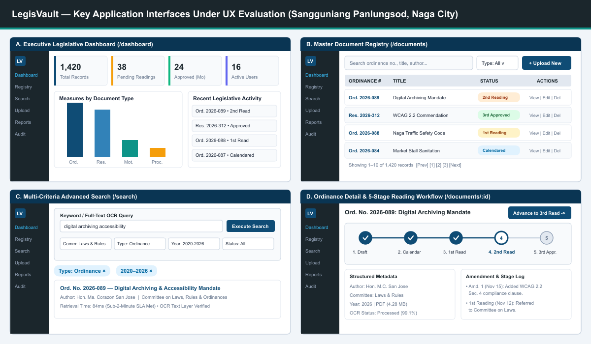
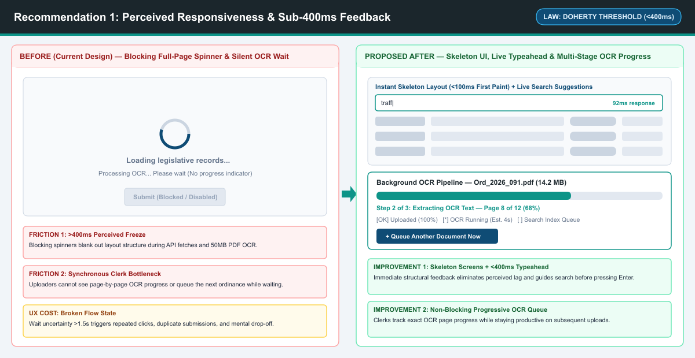
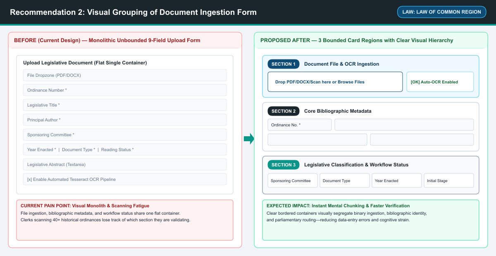
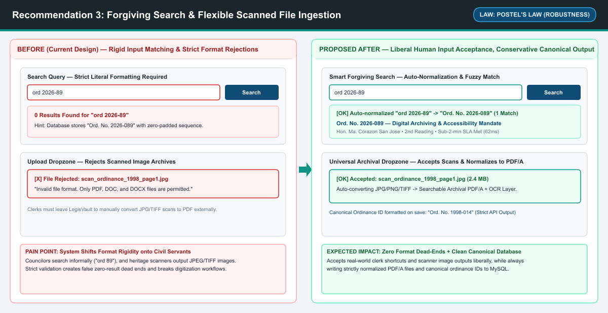
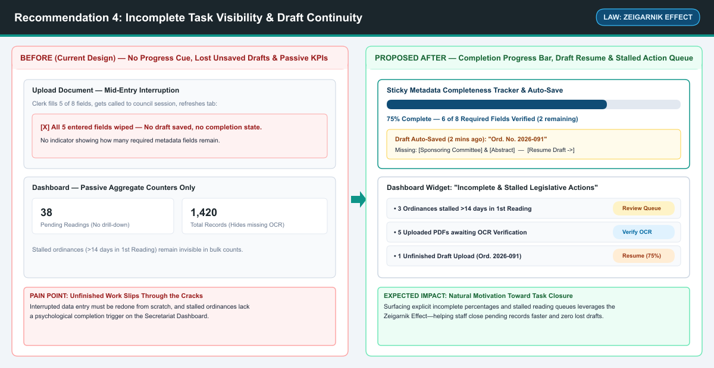
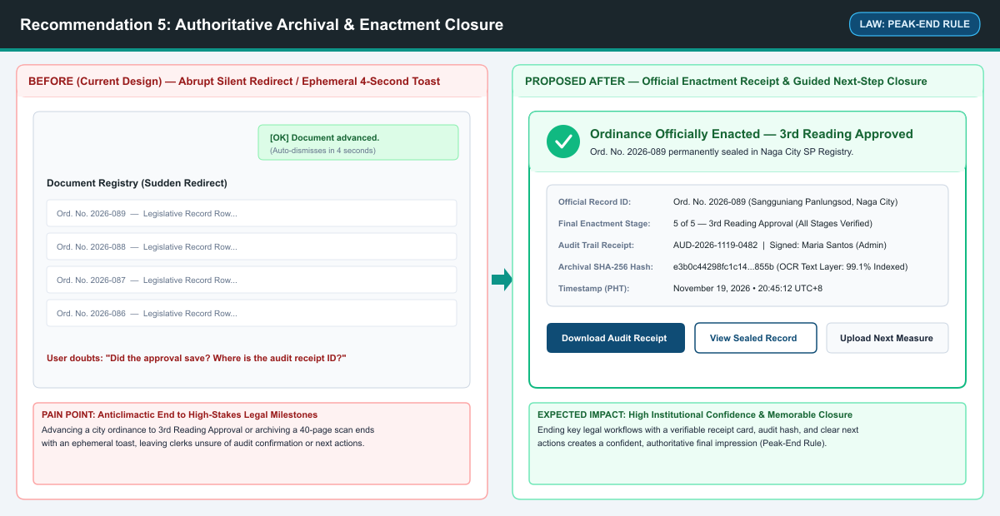
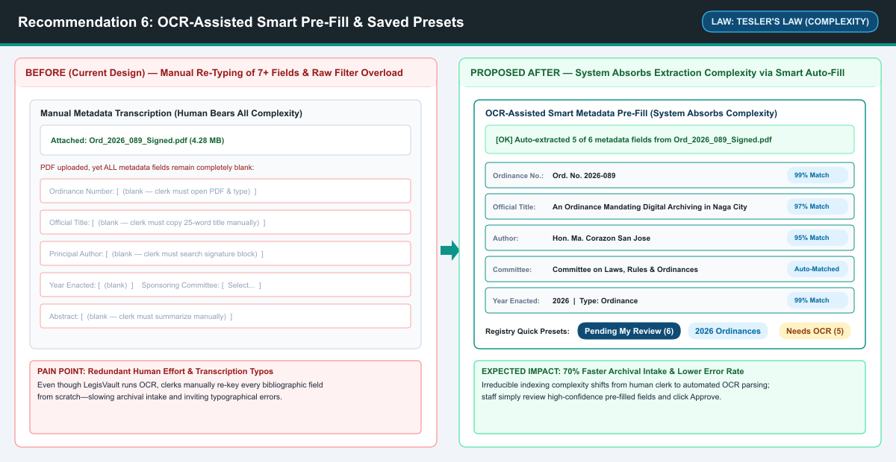
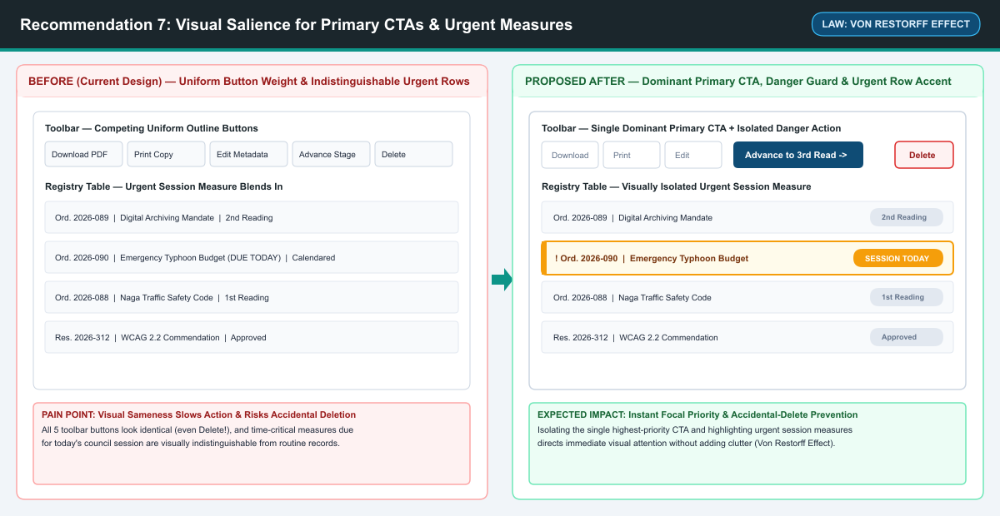

# Laws of UX Evaluation & Redesign Case Study: LegisVault
## Integrated Digital Records and Information Management System
**Sangguniang Panlungsod Secretariat Office — City Government of Naga, Philippines**  
**Academic Year 2025–2026 | Capstone UX Case Study & Evaluation Report**

| Attribute | Detail |
| :--- | :--- |
| **Project Title** | LegisVault — Legislative Records, OCR Archival & Reading Workflow Platform |
| **Target Audience** | SP Secretariat Admins, Records Uploaders/Clerks, City Councilors, & Aging/PWD Officials |
| **Architecture** | 3-Tier SPA (React 18 + Tailwind CSS, Laravel 11 RESTful API, MySQL 8.0, WCAG 2.2 AA) |
| **Evaluation Scope** | 7 Unknowingly Applied Laws of UX + 7 Evidence-Backed Redesign Recommendations |
| **Reference Framework** | *Laws of UX* (Jon Yablonski, [lawsofux.com](https://lawsofux.com/)) & Cognitive Ergonomics Primary Literature |

---

## Section 1: Proposed Application Overview & Case Study

### 1.1 Application Context, Problem Statement & Primary Value Proposition
**LegisVault** is an enterprise-grade, accessible, and integrated digital records and information management web application designed for the **Sangguniang Panlungsod (City Council) Secretariat Office of Naga City** under Republic Act No. 7160 (Local Government Code of 1991).

- **Core Problem Statement:** Decades of paper-based bound ledgers and disconnected spreadsheets at the Naga City SP Secretariat create three severe institutional bottlenecks:
  1. **30–90 minute manual retrieval latency** when verifying historical ordinances, tax schedules, or zoning rules during active council sessions.
  2. **Catastrophic physical degradation risk** from typhoons, humidity, and flooding in the Bicol River basin.
  3. **Zero real-time visibility** across the five statutory parliamentary reading stages (`Draft Received` → `Calendared` → `1st Reading` → `2nd Reading` → `3rd Reading Approval`) and zero forensic accountability.
  4. **Systemic exclusion of persons with disabilities and aging officials**, evidenced by our prior WCAG 2.2 Level AA audit of the national LEGIS portal (`legis.com.ph`), which scored **56/100 (Needs Improvement)**.

- **Primary Value Proposition:** LegisVault unifies automated Tesseract OCR digitization, sub-2-minute multi-criteria legislative retrieval, immutable 5-stage workflow tracking, tripartite Role-Based Access Control (**Admin**, **Uploader**, **Viewer**), polymorphic audit logging, and native **WCAG 2.2 Level AA / RA 7277** inclusive design in a single cohesive platform.

### 1.2 Target User Cohorts & Main User Flows
1. **Role-Based Authentication & Workspace Onboarding (`Login.jsx` → `Dashboard.jsx`):** Sanctum bearer-token authentication routes Admins, Uploaders, and Viewers to role-scoped navigation rails and live legislative KPI cards.
2. **Multi-Criteria Legislative Search & Retrieval (`SearchPage.jsx` & `DocumentRepository.jsx`):** Councilors and researchers filter 1,400+ enactments concurrently by keyword/OCR text, ordinance number, sponsoring committee, enacted year, document type, and reading stage in under 2 minutes.
3. **Document Digitization & Metadata Indexing (`UploadDocument.jsx`):** Records clerks upload PDF/DOCX enactments, capture 7 mandatory bibliographic metadata fields, and trigger automated OCR text extraction.
4. **5-Stage Legislative Reading Workflow Tracking (`OrdinanceDetail.jsx` + `WorkflowTracker.jsx`):** Authorized clerks advance legislative measures sequentially across the 5 statutory stages with session dates and committee notes.
5. **Administrative Governance & Forensic Auditing (`UserManagement.jsx` & `AuditLogs.jsx`):** Secretariat administrators manage user roles, committees, analytical reports, and inspect JSON-diffed audit trails.

### 1.3 Key Interfaces Evaluated

*Figure 1: Composite high-fidelity UI overview of LegisVault's four primary operational screens evaluated against Laws of UX heuristics: (A) Executive Dashboard, (B) Master Document Registry, (C) Multi-Criteria Advanced Search, and (D) Ordinance Detail & 5-Stage Reading Workflow.*

---

## Section 2: UX Evaluation (Unknowingly Applied Laws of UX)

A retrospective cognitive-ergonomics audit of `legisvault-frontend` revealed **7 Laws of UX** already functioning effectively across our current design—even though early sprints prioritized 3-tier functional requirements and WCAG 2.2 Level AA compliance rather than explicitly targeting psychological UX laws.

| # | UX Law Identified | LegisVault Interface Evidence | Primary UX Impact |
| :--- | :--- | :--- | :--- |
| **1** | **Jakob's Law** | `Sidebar.jsx`, `MainLayout.jsx`, `Header.jsx`, `UploadDocument.jsx` | Near-zero training friction via familiar SaaS spatial conventions |
| **2** | **Fitts's Law** | `AccessibleButton.jsx` (44×44px), `UploadDocument.jsx` dropzone | Faster pointer acquisition for aging/motor-impaired officials |
| **3** | **Hick's Law** | Role-filtered `Sidebar.jsx` (4–7 links), 4 KPIs, 10-row pagination | Prevents choice paralysis during live legislative sessions |
| **4** | **Miller's Law** | 5-stage `WorkflowTracker.jsx`, 5 table columns, 4 filter facets | Keeps working memory load well within the 7 ± 2 cognitive ceiling |
| **5** | **Law of Proximity** | `FormField.jsx` vertical label/input/alert stack, row action cluster | Eliminates label/error misattribution, especially at 200–400% zoom |
| **6** | **Law of Similarity** | `StatusBadge.jsx` multi-signal pills & standardized button variants | Instant cross-screen pattern recognition across all 8 modules |
| **7** | **Aesthetic-Usability Effect** | Civic Navy/Slate palette, Inter typography, generous whitespace | Elevates institutional credibility and user adoption confidence |

### 2.1 Jakob's Law *(Jakob Nielsen, 2000)*
- **Interface Evidence:** `MainLayout.jsx`, `Sidebar.jsx`, `Header.jsx`, `DocumentRepository.jsx`, and `UploadDocument.jsx` adhere to canonical enterprise web conventions: a persistent left-docked vertical navigation rail with brand identity top-left, utility controls (High Contrast toggle, notifications, user profile/logout) top-right, search/filter bar positioned immediately above a paginated data table, and a dashed drag-and-drop upload zone.
- **UX Impact Analysis:** Naga City SP clerks and councilors already accustomed to Google Workspace, Microsoft 365, and modern e-government portals transfer existing mental models effortlessly, drastically reducing onboarding latency and support requests.

### 2.2 Fitts's Law *(Paul Fitts, 1954)*
- **Interface Evidence:** `AccessibleButton.jsx`, `Sidebar.jsx`, and `DocumentRepository.jsx` enforce a minimum **44×44px** interactive click/touch target (exceeding WCAG 2.2 SC 2.5.8's 24×24px minimum). `UploadDocument.jsx` provides a full-width dropzone target, and `WorkflowTracker.jsx` positions the primary *"Advance to [Next Stage]"* button immediately adjacent to the workflow header.
- **UX Impact Analysis:** Large hit areas combined with minimal cursor travel distance reduce miss-clicks and target acquisition time—directly empowering aging city councilors, users with fine-motor tremors, and tablet use on the session floor.

### 2.3 Hick's Law *(William Edmund Hick & Ray Hyman, 1952)*
- **Interface Evidence:** `Sidebar.jsx` dynamically prunes navigation options by RBAC role: **Viewers** see only **4** destinations (`Dashboard`, `Registry`, `Search`, `Reports`), **Uploaders** see **5** (`+Upload`), and **Admins** see **7** (`+Audit Trail`, `User Management`). `Dashboard.jsx` bounds headline metrics to **4** KPI cards and **5** recent records, and `DocumentRepository.jsx` paginates to **10** rows per page.
- **UX Impact Analysis:** Removing unauthorized controls and constraining simultaneous visual options eliminates decision paralysis, enabling rapid record retrieval well inside LegisVault's sub-2-minute SLA.

### 2.4 Miller's Law *(George A. Miller, 1956)*
- **Interface Evidence:** `WorkflowTracker.jsx` chunks the entire statutory legislative journey into exactly **5** sequential milestones (`Draft Received` → `Calendared` → `1st Reading` → `2nd Reading` → `3rd Reading Approval`). `DocumentRepository.jsx` organizes table metadata into **5** columns and **4** filter dropdowns, while `SearchPage.jsx` externalizes active constraints as removable filter pills.
- **UX Impact Analysis:** Keeping information chunks within the 5–7 item optimum prevents short-term working memory overload, allowing officials to parse any measure's legal posture at a single glance.

### 2.5 Law of Proximity *(Max Wertheimer, 1923)*
- **Interface Evidence:** `FormField.jsx` binds each persistent `<label>`, input field, helper hint, and `role="alert"` error message inside a tight vertical stack (`space-y-1.5`), separated by generous margins from neighboring fields. Row actions (`View`, `Edit`, `Delete`) sit tightly clustered at the trailing right edge of each record in `DocumentRepository.jsx`.
- **UX Impact Analysis:** Spatial proximity ensures zero ambiguity between inputs, validation alerts, and record actions—vital for low-vision users operating at 200–400% screen magnification.

### 2.6 Law of Similarity *(Gestalt Psychology)*
- **Interface Evidence:** `StatusBadge.jsx` applies identical pill geometry and dual-signal (color + icon + text) encoding across `Dashboard.jsx`, `DocumentRepository.jsx`, `SearchPage.jsx`, and `OrdinanceDetail.jsx`. Similarly, `AccessibleButton.jsx` standardizes visual semantics across `primary`, `outline`, and `danger` variants.
- **UX Impact Analysis:** Consistent visual grammar builds immediate cross-screen recognition: once learned on the Dashboard, status badges and action buttons are decoded effortlessly everywhere—including by staff with color-vision deficiency.

### 2.7 Aesthetic-Usability Effect *(Kurosu & Kashimura, 1995)*
- **Interface Evidence:** `tailwind.config.js` and `index.css` enforce a cohesive institutional visual system: Deep Civic Navy (`#0F4C75`), Slate Charcoal (`#1B262C`), high-luminance Surface (`#F8FAFC`), Inter typography, crisp card borders, balanced whitespace, and 3px teal focus indicators.
- **UX Impact Analysis:** Visual refinement elevates perceived reliability and institutional authority, fostering trust among senior Sangguniang Panlungsod members transitioning from traditional paper ledgers.

---

## Section 3: UX Recommendations (Laws of UX to Apply)

Auditing our current React frontend revealed **7 concrete usability friction points**. Below, each pain point is resolved by explicitly applying an unapplied **Law of UX** paired with side-by-side **Before vs. Proposed After** visual evidence.

### 3.1 Perceived Responsiveness & Sub-400ms Interactive Feedback
- **Current Issue / Pain Point:** In `Dashboard.jsx`, `DocumentRepository.jsx`, and `UploadDocument.jsx`, asynchronous API fetches and multi-page Tesseract OCR jobs display a centered generic `LoadingSpinner` or static binary `ocrProcessing` state without layout previews or granular progress feedback. During 10–50 MB PDF ingestion, waits exceeding 400ms feel frozen and block clerks from queuing additional uploads.
- **Proposed UX Law:** **Doherty Threshold** *(Doherty & Thadani, 1982)* — Productivity soars when computer and user interact at `<400ms` so neither waits on the other.
- **Actionable Re-design Recommendation:** Replace blocking spinners with **content-aware skeleton screens** matching exact KPI cards and table rows (`<100ms` first paint); add **debounced `<400ms` typeahead search suggestions** in `SearchPage.jsx`; and upgrade `UploadDocument.jsx` with a **non-blocking, multi-stage live OCR progress bar** (`Uploading 100%` → `OCR Page 8 of 12` → `Indexing`) plus a **"+ Queue Another Document"** trigger.

*Figure 2: Side-by-side Before vs. Proposed After comparison applying the Doherty Threshold.*

---

### 3.2 Visual Segmentation of High-Density Document Ingestion Forms
- **Current Issue / Pain Point:** `UploadDocument.jsx` stacks 9+ heterogeneous inputs (file dropzone, Ordinance Number, Title, Author, Committee, Year, Document Type, Reading Status, Abstract, OCR toggle) inside a single flat vertical container, causing visual monotony and scanning fatigue during batch archival sessions.
- **Proposed UX Law:** **Law of Common Region** *(Stephen Palmer, 1992)* — Elements sharing a clearly bounded perimeter are perceived as a unified functional group.
- **Actionable Re-design Recommendation:** Segment `UploadDocument.jsx` into **3 distinctly bordered card containers** with numbered section headers: **Section 1** (*Document File & OCR Ingestion*, sky-tinted card), **Section 2** (*Core Bibliographic Metadata*, crisp white card), and **Section 3** (*Legislative Classification & Initial Status*, light slate card). Enclose active filter pills in `SearchPage.jsx` within a dedicated tinted filter tray.

*Figure 3: Side-by-side Before vs. Proposed After comparison applying the Law of Common Region.*

---

### 3.3 Forgiving Legislative Search & Flexible Scanned Image Ingestion
- **Current Issue / Pain Point:** `SearchPage.jsx` fails to match informal clerk shorthand (e.g., `"ord 2026-89"`) against canonical zero-padded records (`"Ord. No. 2026-089"`), while `UploadDocument.jsx` rejects standard flatbed scanner image outputs (`.jpg`, `.png`, `.tiff`) despite supporting OCR—forcing clerks into external PDF conversion tools.
- **Proposed UX Law:** **Postel's Law / Robustness Principle** *(Jon Postel, 1980)* — Be liberal in what you accept from humans, and conservative (strict, canonical) in what you store and output.
- **Actionable Re-design Recommendation:** Add **query auto-normalization and fuzzy matching** in `SearchController.php` / `SearchPage.jsx` (mapping `"ord 2026-89"` → `"Ord. No. 2026-089"` with a transparent confirmation banner), and expand `UploadDocument.jsx` to accept `.jpg`, `.png`, and `.tiff` scans—automatically converting them into standardized archival PDF/A files with OCR text layers and canonical Ordinance Numbers on save.

*Figure 4: Side-by-side Before vs. Proposed After comparison applying Postel's Law.*

---

### 3.4 Incomplete Task Visibility, Draft Auto-Save & Stalled Queue Alerts
- **Current Issue / Pain Point:** Clerks interrupted mid-upload lose all unsaved metadata upon page refresh because `UploadDocument.jsx` lacks draft persistence and field completeness indicators. Simultaneously, `Dashboard.jsx` shows passive aggregate totals (`38 Pending Readings`) that hide stalled measures (`>14 days` in `1st Reading`) and unverified OCR records.
- **Proposed UX Law:** **Zeigarnik Effect** *(Bluma Zeigarnik, 1927)* — People remember and feel psychologically driven to finish uncompleted or interrupted tasks.
- **Actionable Re-design Recommendation:** Add a sticky **Metadata Completeness Progress Bar** (`75% Complete — 6 of 8 Required Fields`) backed by automatic `localStorage` draft saving and a **"Resume Draft"** banner in `UploadDocument.jsx`. Add an actionable **"Incomplete & Stalled Legislative Actions"** widget to `Dashboard.jsx` surfacing stalled readings, unverified OCR files, and paused drafts with one-click deep links.

*Figure 5: Side-by-side Before vs. Proposed After comparison applying the Zeigarnik Effect.*

---

### 3.5 Authoritative Archival & 3rd Reading Enactment Confirmation
- **Current Issue / Pain Point:** Completing major institutional milestones—such as advancing a measure to **3rd Reading Approval (Enactment)** in `WorkflowTracker.jsx` or sealing a digitized archive in `UploadDocument.jsx`—terminates abruptly with an auto-dismissing 4-second `Toast` and immediate redirect, leaving clerks without a verifiable audit receipt or clear next step.
- **Proposed UX Law:** **Peak-End Rule** *(Daniel Kahneman, 1999)* — Users judge an experience disproportionately by how they felt at its peak and at its final moment.
- **Actionable Re-design Recommendation:** Replace ephemeral toasts at milestone peaks with an authoritative **Official Enactment & Archival Receipt Modal** showing the Ordinance Number, 5-of-5 stage confirmation, Audit Trail Receipt ID, SHA-256 archival checksum, OCR accuracy score, PHT timestamp, and three explicit next actions (*Download Audit Receipt*, *View Sealed Record*, *Upload Next Measure*).

*Figure 6: Side-by-side Before vs. Proposed After comparison applying the Peak-End Rule.*

---

### 3.6 OCR-Assisted Smart Metadata Pre-Fill & One-Click Filter Presets
- **Current Issue / Pain Point:** Even though LegisVault executes OCR, `UploadDocument.jsx` leaves all 7+ metadata fields blank after file upload, forcing clerks to manually transcribe titles, ordinance numbers, authors, and years. In `DocumentRepository.jsx`, all 5 filter dropdowns are exposed simultaneously even for routine daily lookups.
- **Proposed UX Law:** **Tesler's Law / Law of Conservation of Complexity** *(Larry Tesler, 1984)* — Shift irreducible complexity from the human user onto the software system.
- **Actionable Re-design Recommendation:** Trigger **OCR-Assisted Smart Metadata Pre-Fill** immediately upon file drop, auto-populating Ordinance Number, Title, Author, Committee, and Year with editable confidence badges (`99% Match — Verify`), and add one-click **Saved Filter Presets** (*Pending My Review*, *2026 Ordinances*, *Needs OCR*) above the registry table while keeping granular filters collapsible.

*Figure 7: Side-by-side Before vs. Proposed After comparison applying Tesler's Law.*

---

### 3.7 Visual Isolation of Primary CTAs, Danger Actions & Urgent Measures
- **Current Issue / Pain Point:** In `OrdinanceDetail.jsx` and `DocumentRepository.jsx`, toolbar actions (`Download`, `Print`, `Edit`, `Advance Stage`, `Delete`) share uniform visual weight—inviting accidental clicks—and urgent measures calendared for today's regular session blend into routine table rows.
- **Proposed UX Law:** **Von Restorff Effect / Isolation Effect** *(Hedwig von Restorff, 1933)* — Among visually similar items, the single item that differs distinctly captures immediate attention and recall.
- **Actionable Re-design Recommendation:** Enforce **one dominant filled Civic Navy (`#0F4C75`) primary CTA per viewport** (`Advance to 3rd Reading`), demote secondary utilities to subtle outline/ghost styling, isolate destructive actions (`Delete`) far-right with crimson warning borders, and highlight session-critical rows with a **6px amber left accent bar** and bold **`SESSION TODAY`** badge.

*Figure 8: Side-by-side Before vs. Proposed After comparison applying the Von Restorff Effect.*

---

## Section 4: Deliverables Summary, Prioritization & References

### 4.1 Implementation Priority Matrix

| UX Law Applied | Target Screen(s) | Core UI/UX Upgrade | Impact | Effort |
| :--- | :--- | :--- | :--- | :--- |
| **Doherty Threshold** | Dashboard, Search, Upload | Skeleton UI, `<400ms` typeahead, live OCR bar | High | Medium |
| **Law of Common Region** | UploadDocument, Search | 3 bordered card regions & filter pill tray | High | Low |
| **Postel's Law** | SearchPage, Upload | Auto-normalized query parser & JPG/TIFF scan ingest | High | Medium |
| **Zeigarnik Effect** | UploadDocument, Dashboard | 75% completeness bar, draft save, stalled queue widget | High | Medium |
| **Peak-End Rule** | WorkflowTracker, Upload | Official Enactment Receipt modal w/ SHA-256 hash | High | Low |
| **Tesler's Law** | UploadDocument, Registry | OCR smart metadata pre-fill & one-click filter presets | Very High | High |
| **Von Restorff Effect** | OrdinanceDetail, Registry | Single dominant primary CTA, danger guard, urgent row | High | Low |

### 4.2 Reference Framework & Academic Citations
1. Yablonski, J. (2020). *Laws of UX: Using Psychology to Design Better Products & Services*. O'Reilly Media. https://lawsofux.com/
2. Nielsen, J. (2000). *Jakob's Law of Internet User Experience*. Nielsen Norman Group. https://www.nngroup.com/videos/jakobs-law-internet-ux/
3. Fitts, P. M. (1954). The information capacity of the human motor system in controlling the amplitude of movement. *Journal of Experimental Psychology*, 47(6), 381–391.
4. Hick, W. E. (1952). On the rate of gain of information. *Quarterly Journal of Experimental Psychology*, 4(1), 11–26.
5. Miller, G. A. (1956). The magical number seven, plus or minus two: Some limits on our capacity for processing information. *Psychological Review*, 63(2), 81–97.
6. Wertheimer, M. (1923). Untersuchungen zur Lehre von der Gestalt II *(Laws of Proximity & Similarity)*. *Psychologische Forschung*, 4, 301–350.
7. Kurosu, M., & Kashimura, K. (1995). Apparent usability vs. inherent usability *(Aesthetic-Usability Effect)*. *CHI '95 Conference Companion*, 292–293.
8. Doherty, W. J., & Thadani, A. J. (1982). The economic value of rapid response time *(Doherty Threshold)*. *IBM Systems Journal*, GE20-0752-0.
9. Palmer, S. E. (1992). Common region: A new principle of perceptual grouping. *Cognitive Psychology*, 24(3), 436–447.
10. Postel, J. (1980). *RFC 761: DoD Standard Transmission Control Protocol (Robustness Principle / Postel's Law)*. IETF.
11. Zeigarnik, B. (1927). Über das Behalten von erledigten und unerledigten Handlungen. *Psychologische Forschung*, 9, 1–85.
12. Kahneman, D. (1999). Objective happiness *(Peak-End Rule)*. In D. Kahneman et al. (Eds.), *Well-Being: The Foundations of Hedonic Psychology* (pp. 3–25).
13. Tesler, L. (1984). *Law of Conservation of Complexity*. Cited in Saffer, D. (2010), *Designing for Interaction* (2nd ed.). New Riders.
14. von Restorff, H. (1933). Über die Wirkung von Bereichsbildungen im Spurenfeld *(Isolation Effect)*. *Psychologische Forschung*, 18(1), 299–342.
15. W3C. (2023). *Web Content Accessibility Guidelines (WCAG) 2.2 Level AA*. https://www.w3.org/TR/WCAG22/ & Republic Act No. 7277 (Philippine Magna Carta for Persons with Disabilities).

