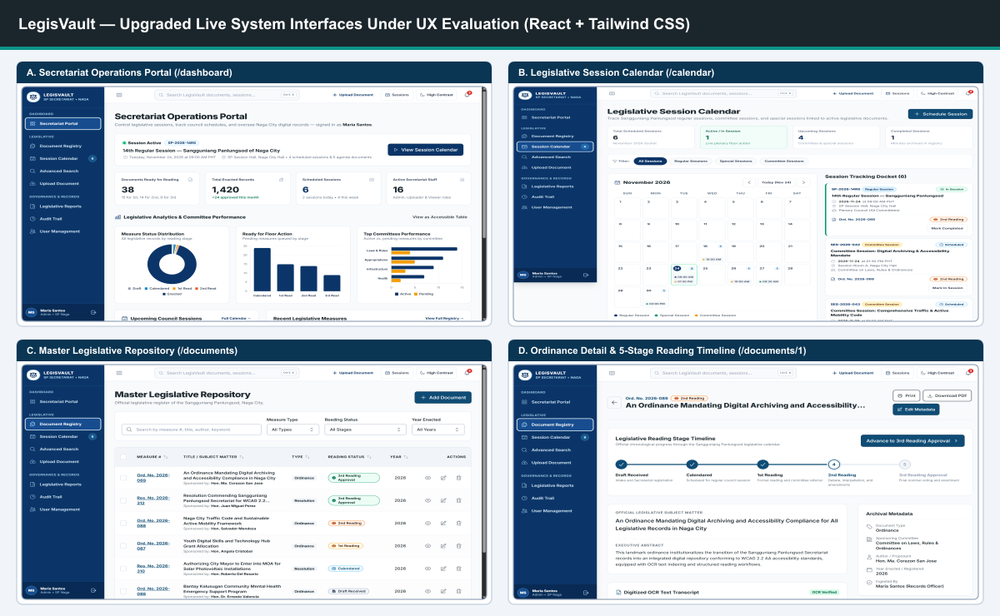

# LegisVault — Integrated Digital Records & Information Management System

**Institutional Partner:** Sangguniang Panlungsod Secretariat Office, Naga City, Philippines  
**Academic Capstone Project | Academic Year 2025–2026**  
**Architecture:** 3-Tier Web Application (`React 18 + Tailwind CSS` · `Laravel 11 RESTful API` · `MySQL 8.0`)  
**Standards Compliance:** W3C WCAG 2.2 Level AA · WAI-ARIA 1.2 · Republic Act No. 7277 · Republic Act No. 10173

---

## System Preview (Upgraded Secretariat Portal & Session Calendar)



---

## Repository Contents

### 1. System Source Code
| Folder | Tier | Technology Stack | Key Capabilities |
| :--- | :--- | :--- | :--- |
| [`legisvault-frontend/`](./legisvault-frontend/) | Presentation Tier | React 18, Tailwind CSS, Vite, Headless UI, Chart.js | Civic Royal-Navy Grouped Portal, Active Session Hero Banner, `Ctrl+K` Command Search, **Legislative Session Calendar (`/calendar`)**, 5-Stage Workflow Tracker, WCAG 2.2 AA & High Contrast Mode |
| [`legisvault-api/`](./legisvault-api/) | Application & Data Tier | Laravel 11 (PHP), Sanctum, Eloquent ORM, MySQL 8.0 | RESTful API, 3-Role RBAC (`Admin`, `Uploader`, `Viewer`), 8 MySQL Migrations, Polymorphic Audit Logs, OCR Pipeline |

### 2. Capstone Documentation & UX/Accessibility Deliverables
| Document | Format | Description |
| :--- | :--- | :--- |
| [`LegisVault_System_Design_Specification.md`](./LegisVault_System_Design_Specification.md) | Markdown (PDF-ready) | Full 3-Tier Architecture, RBAC Feature Matrix, Session Calendar & Workflow Specs, Inclusive Design System, ER Schema, & API Reference |
| [`LegisVault_Laws_of_UX_Case_Study.pdf`](./LegisVault_Laws_of_UX_Case_Study.pdf) | PDF (13 Pages) | Updated Laws of UX Evaluation with Annotated Live Screenshots (7 Unknowingly Applied Laws + 7 Before vs. After Redesigns) |
| [`LegisVault_Laws_of_UX_Case_Study.md`](./LegisVault_Laws_of_UX_Case_Study.md) | Markdown | Editable source for the Laws of UX Case Study (renders embedded visual diagrams in [`ux_case_study_assets/`](./ux_case_study_assets/)) |
| [`LegisVault_System_Creation_Prompts_Documentation.md`](./LegisVault_System_Creation_Prompts_Documentation.md) | Markdown | Detailed engineering log of the system creation prompts used to scaffold, build, upgrade, and debug LegisVault |
| [`LegisVault_Accessibility_Audit_UX_Case_Study_Deck.pptx`](./LegisVault_Accessibility_Audit_UX_Case_Study_Deck.pptx) | PowerPoint (10 Slides) | Capstone Presentation Deck summarizing WCAG 2.2 audit findings, POUR breakdowns, and LegisVault inclusive design |

---

## Core System Modules
1. **Secretariat Operations Portal (`/dashboard`):** Executive Active Session banner (`SP-2026-14RS`), 4 KPI metric cards, 3-column analytics row (Measure Status Distribution, Ready for Floor Action, Top Committees Performance) with WCAG 1.1.1 accessible table fallback, Upcoming Council Sessions docket, and Recent Documents feed.
2. **Legislative Session Calendar (`/calendar`):** Interactive monthly calendar grid and Session Tracking Docket managing Regular Sessions, Committee Sessions, and Special Sessions linked directly to legislative documents and reading stages, with modal scheduling.
3. **Role-Based Access Control (RBAC):** Three strict user roles — `Admin`, `Uploader`, and `Viewer` — enforced by Laravel Sanctum + custom `RoleMiddleware`.
4. **Metadata Indexing & Document Registry (`/documents` & `/upload`):** Captures Ordinance Number, Title, Author, Sponsoring Committee, Year Enacted, Document Type, and Reading Status with MySQL indexing and automated OCR processing.
5. **Legislative Reading Workflow Tracking (`/documents/:id`):** Enforces chronological transitions: `Draft Received` → `Calendared` → `1st Reading` → `2nd Reading` → `3rd Reading Approval`.
6. **Advanced Search Engine (`/search` + `Ctrl+K` Global Bar):** Multi-criteria full-text and metadata filtering engineered for sub-2-minute legislative retrieval.
7. **Inclusive Design (WCAG 2.2 Level AA):** Skip links, 3px teal focus rings, 44×44px minimum hit targets, persistent form labels, `aria-live` announcements, multi-signal status badges, and High Contrast Mode.

---

## Quick Start (Local Development)

### Backend (`legisvault-api`)
> Requires PHP 8.2+, Composer, and MySQL 8.0 (e.g., Laragon or XAMPP).
```bash
cd legisvault-api
composer install
cp .env.example .env
php artisan key:generate
php artisan migrate --seed
php artisan serve
```

### Frontend (`legisvault-frontend`)
> Requires Node.js 18+ and npm.
```bash
cd legisvault-frontend
npm install
npm run dev
```
The React SPA launches via Vite (`http://localhost:5173`) and proxies `/api` requests automatically to `http://localhost:8000`.
